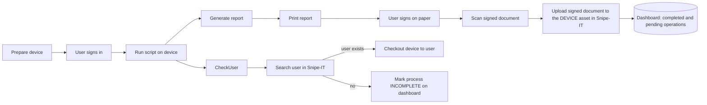

# IMPLEMENTATION PROMPT — Handover Portal (persistence + Snipe-IT integration + operations dashboard)

You are a coding agent working inside an EXISTING, working repository. Your job is to extend it in small, verified steps. You are NOT redesigning it. Read this whole document before touching anything. When this document and your own instincts disagree, this document wins. When this document is silent, do NOT invent: write the question into `docs/OPEN_QUESTIONS.md`, take the most conservative option, and continue.

---

## 0. The seven rules that override everything

1. **Do not break what exists.** The existing code is deliberately layered (see §2). The 29 existing tests must stay green after every commit. Never edit an existing test to make it pass. The only existing test file you may touch is `tests/conftest.py`, and only for the single change described in §6 Phase 1.
2. **Small steps, one concern per branch, one logical change per commit.** Never commit to `main` or `feature/sso`. Never merge branches. Never force-push. Never rewrite history.
3. **Tests first for logic, tests alongside for everything else.** No phase is "done" without its tests passing.
4. **Security is a red line.** No secret in git, ever. No SQL string-building. No logging of tokens, passwords or full agent payloads. If you are unsure whether something is safe, treat it as unsafe and use the stricter option.
5. **Use only the technologies in §3.** Do not add a library, framework, build tool or service that is not listed there. If you believe one is needed, STOP and write it to `docs/OPEN_QUESTIONS.md`.
6. **Follow H-Caliper, i.e. the 12 principle files** (Appendix A, explained in §4). Create them in Phase 0, obey them in every phase, and update them in the final phase (§7).
7. **Never claim something works unless you ran it and saw it pass.** Your final report (§8) must list the exact commands you ran and their results. If you could not run something (for example Docker is unavailable), say so plainly and mark it BLOCKED. Do not simulate results.

---

## 1. What this product is (facts, do not re-derive)

A company IT team hands laptops to employees. Today it is manual across ManageEngine ServiceDesk ("Lab Care", tickets) and Snipe-IT (assets). Engineers forget steps (install/activate software, assign in Snipe-IT, upload the signed paper, even getting it signed) and nobody has visibility.

**What exists today (verified from the repository):**
- FastAPI app, entry `main.py` → `app/main.py:create_app()`.
- Entra ID SSO (`app/auth.py`); `SSO_ENABLED=false` gives a dev user and a loud warning.
- Engineer opens the portal, gets a short code (`A7-X3-Q9`, 10 min TTL, in memory: `app/services/sessions.py`), runs an agent one-liner on the employee's device (`static/agent.ps1` / `agent.sh`); the agent POSTs a hardware/software/activation report to `/api/session/{code}/submit`; the browser polls `/api/session/{code}/data`.
- Read-only Snipe-IT lookup by serial (`app/routers/snipeit.py`) using one shared service token.
- UI: Jinja templates + vanilla JS + Tailwind v4 with shadcn token architecture (`styles/app.css` → built to `static/css/app.css`, committed).
- 29 passing tests (25 characterization + 4 diagnostics) plus Playwright clipboard tests that need browsers.
- No database. No writes to Snipe-IT. No dashboard.

**Hard business constraints:**
- Legal rejected electronic signatures. The handover sheet is signed on PAPER, scanned, and the scan is stored. This is final.
- Physical stock is the reference; Snipe-IT data is not fully accurate.
- Snipe-IT terminology is used as-is everywhere (UI, API, code, DB): **checkout** = assign an asset to a user; **checkin** = return an asset from a user. Do not use "assign", "deliver" or "return" as names in code or API (they may appear in explanatory UI text only).
- The portal is a standalone service. Snipe-IT stays the system of record for assignments. The portal stores workflow state and must NOT become a second asset inventory.

---

## 2. Architecture you must preserve and extend

```
routers  →  services  →  repositories / clients  →  db / external systems
   ↓            ↓
  dto        domain (pure Python, imports nothing from app.*)
```

Existing modules (do not restructure): `app/config.py` (the ONLY place env vars are read), `app/dependencies.py`, `app/auth.py`, `app/schemas.py`, `app/services/sessions.py`, `app/routers/{pages,agent,snipeit,health,diag}.py`.

**Dependency rules (enforced by a test you will write):**
- `app/domain/*` imports only the standard library.
- `app/routers/*` never import `app.db.*` or `httpx` directly. They call services.
- `app/services/*` never import `fastapi`.
- `app/repositories/*` are the only code that builds SQL/ORM queries.
- `app/clients/*` are the only code that talks to external HTTP systems.
- Routers stay thin: parse, authorize, call one service, return a DTO. No business logic in routers.

**New package layout you will create:**

```
app/
  config.py                      (extend: new settings only here)
  db/
    __init__.py
    base.py                      declarative Base, naming convention
    engine.py                    lazy engine/sessionmaker factory (NOT created at import)
    models/
      __init__.py
      handover.py                Handover, HandoverStage, AgentReport, Document, Event
  domain/
    __init__.py
    stages.py                    Stage enum, StageStatus, ordering, dependencies
    handover_rules.py            pure functions: derive status, missing steps, can_transition
  repositories/
    __init__.py
    handovers.py
    events.py                    insert-only (no update/delete methods)
  clients/
    __init__.py
    snipeit.py                   SnipeItClient (all Snipe-IT HTTP lives here)
  services/
    handovers.py                 orchestration + idempotency + verification
    documents.py                 safe file storage
    dashboard.py                 aggregates
  dto/
    __init__.py
    handover.py                  pydantic request/response models for the new API
  routers/
    handovers.py
    documents.py
    dashboard.py
  logging_config.py              logging setup + request-id middleware helper
alembic/ + alembic.ini           migrations
deploy/snipeit-dev/              local Snipe-IT docker compose (dev only)
docs/principles/                 the 12 principle files (Appendix A)
docs/OPEN_QUESTIONS.md
docs/snipeit-api-verified.md
templates/handovers.html, templates/handover_detail.html
static/js/handovers.js, static/js/handover_detail.js
tests/ (new files only; see each phase)
```

---

## 3. Approved technology (nothing else)

Existing (keep): Python, FastAPI, uvicorn, Jinja2, httpx, python-dotenv, pydantic, authlib, itsdangerous, pytest, pytest-playwright, Tailwind CSS v4 (CLI), vanilla JS.

**Add exactly these and no others** (put runtime ones in `requirements.txt`, test ones in `requirements-dev.txt`, pin with `>=` like the existing file):
- Runtime: `sqlalchemy>=2.0` (async API), `alembic`, `asyncpg`, `aiosqlite`, `python-multipart` (file upload).
- Dev/test: `pytest-asyncio`, `pytest-cov`.

Database policy: **PostgreSQL is the production target; SQLite (aiosqlite) is used for local dev and the automated test suite.** Both are selected by one setting `DATABASE_URL`. Code must work on both: use SQLAlchemy `Uuid`, `DateTime(timezone=True)`, `JSON().with_variant(JSONB(), "postgresql")`, and partial indexes declared with both `postgresql_where=` and `sqlite_where=`. No raw SQL dialect features.

Snipe-IT local instance: Docker Compose, dev only (Phase 4).

Forbidden: new frontend frameworks, bundlers other than the existing Tailwind CLI step, an ORM other than SQLAlchemy, Redis/Celery/queues, any cloud service, any CDN or Google-Fonts request (the app must work offline on a LAN).

---

## 4. H-Caliper = the 12 principle files

The owner's working system is called **H-Caliper**, and it IS the set of 12 principle files in Appendix A (`docs/principles/01` … `12`): tests, logging, graph, security, business, clean architecture, UI/UX, git, decisions, tech stack, clean code, performance.

Therefore "following H-Caliper" means exactly this:
1. Create the 12 files in Phase 0, byte for byte from Appendix A.
2. Obey their rule IDs (TST-xx, LOG-xx, GRF-xx, SEC-xx, BIZ-xx, ARC-xx, UIX-xx, GIT-xx, TEC-xx, CLN-xx, PRF-xx) in every phase.
3. Keep them true: update them in the same branch as any change that makes them stale, and do the full sync in the final phase (§7), starting with the graph file.
4. In your final report, state for each of the 12 files whether it was changed and why.

---

## 5. The business flow you are implementing (from the owner's diagram)



**Owner decision (final): the signed paper is attached to the DEVICE (the Snipe-IT asset), not to the user.** Consequences:
- The scan upload depends only on the scan existing and the asset existing in Snipe-IT. It does NOT depend on the recipient existing.
- When the recipient does NOT exist in Snipe-IT, stage 4 and stage 5 are `blocked`, so the handover shows as **stalled/incomplete** on the dashboard with the missing step named ("Recipient not found in Snipe-IT"). The signed sheet can still be uploaded to the asset meanwhile; it is not held back.
- If the asset itself is not found in Snipe-IT, stage 9 is `failed` with that reason (the portal never creates assets).
- Never create a Snipe-IT user silently.

### 5.1 Stages (fixed, in this order — implement in `app/domain/stages.py`)

| # | Stage key | How it passes | Depends on |
|---|---|---|---|
| 1 | `device_prepared` | Engineer confirms (manual) | — |
| 2 | `user_signed_in` | Engineer confirms (manual) | 1 |
| 3 | `agent_report` | Agent report received AND report serial equals the handover's `device_serial` | 1 |
| 4 | `recipient_check` | Engineer confirms a Snipe-IT user match for the recipient | 3 |
| 5 | `checkout` | Portal performs Snipe-IT checkout and then VERIFIES it | 4 |
| 6 | `report_printed` | Engineer confirms the report page was printed (manual) | 3 |
| 7 | `user_signed` | Engineer confirms paper was signed (manual) | 6 |
| 8 | `document_scanned` | Valid scan file uploaded and stored | 7 |
| 9 | `document_pushed` | Portal uploads the scan to the device's Snipe-IT asset and then VERIFIES the file is listed on that asset | 8 |

Stage status values: `pending`, `passed`, `failed`, `blocked`, `skipped` (skipped is NOT used in v1; do not implement skipping).

### 5.2 Rules (implement as pure functions in `app/domain/handover_rules.py`)

- `derive_status(stages) -> draft | in_progress | stalled | completed | cancelled`:
  - `cancelled` is set explicitly and never derived over.
  - `completed` only when all 9 stages are `passed`.
  - `stalled` when any stage is `failed` or `blocked`.
  - `draft` when every stage is `pending`.
  - otherwise `in_progress`.
  - The time-based "no progress for N days" stalled rule is an OPEN decision: do NOT implement it.
- `missing_steps(stages) -> list[{stage, status, reason, hint}]`: every stage that is not `passed`, with the stored reason and a human hint (e.g. "Recipient not found in Snipe-IT — create the user in Snipe-IT, then retry stage 4"). This feeds the dashboard's "what is missing" column.
- `can_run(stage, stages) -> (bool, reason)`: a stage may only run if all its dependencies are `passed`.
- A handover is only `completed` after the portal has VERIFIED Snipe-IT state: asset assigned to the confirmed recipient (stage 5) and the file present (stage 9). A button click is never proof.
- One ACTIVE handover per device serial (active = status not in `completed`, `cancelled`), enforced by a partial unique index.

---

## 6. Phases (execute in order; each phase = its own branch from `feature/shadcn-tailwind-ui`)

**Per-phase protocol (always):**
1. `git checkout feature/shadcn-tailwind-ui` (or the previous phase's branch if the owner has not merged — see "Branch base" below), then `git checkout -b <branch-name>`.
2. Write the tests for the phase first (they will fail).
3. Implement until they pass.
4. Run the full suite: `python -m pytest tests -q --ignore=tests/test_clipboard_playwright.py` — all 29 original tests must still pass.
5. If you touched templates or `styles/app.css`: run `npm run build:css` and commit the generated `static/css/app.css`.
6. Update the docs the phase touches (README project-structure block, `docs/principles/03-graph-principles.md` LIVE GRAPH section, `docs/principles/09-decisions.md` if you made a decision).
7. Commit with a Conventional Commit message. Never commit `.env`, `data/`, `*.db`, uploaded files, or `deploy/snipeit-dev/.env`.

**Branch base:** each phase branch starts from the previous phase's branch (the owner merges later). Branch names are fixed:

| Phase | Branch |
|---|---|
| 0 | `chore/principles-and-housekeeping` |
| 1 | `feature/handover-persistence` |
| 2 | `feature/handover-domain-and-api` |
| 3 | `feature/snipeit-client-service` |
| 4 | `feature/snipeit-local-dev-instance` |
| 5 | `feature/snipeit-write-ops` |
| 6 | `feature/handover-documents` |
| 7 | `feature/handover-dashboard` |
| 8 | `fix/security-hardening` |
| 9 | `docs/final-sync` |

### Phase 0 — Principles and housekeeping (`chore/principles-and-housekeeping`)
- Create the 12 files (H-Caliper) from Appendix A exactly under `docs/principles/` (copy between the BEGIN/END markers; do not summarize or "improve" them).
- Create `docs/OPEN_QUESTIONS.md` (empty list with a header) and `docs/context/` (the owner may drop the briefing here; if `docs/context/handover-portal-system-briefing.md` exists, read it).
- Add `.gitattributes` with `* text=auto eol=lf` (and binary markers for images/fonts) to stop line-ending noise. Do not renormalize unrelated files in the same commit.
- Add `pytest.ini`: `asyncio_mode = auto`, `testpaths = tests`.
- Add `tests/test_architecture_rules.py` that enforces the dependency rules in §2 by scanning imports with `ast` (domain imports stdlib only; routers do not import `app.db`/`httpx`; services do not import `fastapi`). Directories that do not exist yet are skipped, not failed.
- Add `tests/test_graph_consistency.py` (spec in principle file 03; it must pass now against the initial graph).
- Acceptance: full suite green; the two new tests pass.

### Phase 1 — Persistence (`feature/handover-persistence`)
1. Config (`app/config.py` only): `DATABASE_URL` (default `sqlite+aiosqlite:///./data/handover.db`), `DOCUMENTS_DIR` (default `./data/documents`), `DOCUMENT_MAX_BYTES` (default 10485760), `SNIPEIT_TIMEOUT_SECONDS` (default 10), `LOG_LEVEL` (default `INFO`). Add them to `.env.example` with safe placeholders. Ensure `data/` is in `.gitignore`.
2. `app/db/base.py`, `app/db/engine.py`: the engine and sessionmaker are created lazily by a function (`get_engine()`, `get_sessionmaker()`), never at import time. Importing the app must not connect to or create any database. `expire_on_commit=False`. A FastAPI dependency `get_session()` yields an `AsyncSession` with commit-on-success / rollback-on-error handled in ONE place.
3. **The one permitted `tests/conftest.py` change:** the fixture `_reload_app_modules` currently reloads every module starting with `app.`. Reloading SQLAlchemy models re-registers tables and crashes. Change the reload filter so it skips `app.db` and `app.domain` and their submodules. Add a test proving `make_client()` can be called twice in one test without error.
4. Models in `app/db/models/handover.py` (UUID primary keys, timezone-aware UTC timestamps):
   - `handovers`: id, ticket_ref (nullable), status, engineer_email, engineer_name, device_serial, snipeit_asset_id (nullable int), snipeit_asset_tag (nullable), recipient_reported_username (nullable, from agent), recipient_snipeit_id (nullable int), recipient_snipeit_username (nullable), recipient_confirmed_by (nullable), recipient_confirmed_at (nullable), created_at, updated_at, closed_at (nullable). Partial unique index on `device_serial` where `status NOT IN ('completed','cancelled')`.
   - `handover_stages`: id, handover_id (FK, cascade), stage, status, reason (nullable text), detail (JSON), actor (nullable), updated_at. Unique (handover_id, stage).
   - `agent_reports`: id, handover_id (FK), payload (JSON), received_at. **Redact** before storing: never store the `partial_key` of `windows_activation`.
   - `documents`: id, handover_id (FK), kind (`signed_sheet`), stored_name, original_name, content_type, size_bytes, sha256, uploaded_by, uploaded_at, pushed_to_snipeit_at (nullable).
   - `events` (append-only): id, handover_id (FK), at, actor, type, detail (JSON). The repository exposes `add()` and read methods only.
5. Alembic configured for async; first migration creates the tables; `render_as_batch=True` for SQLite. Document `alembic upgrade head` in README.
6. Tests: migration applies cleanly on SQLite; partial unique index rejects a second active handover for the same serial but allows one after the first is completed/cancelled; events repository has no update/delete; importing `main` does not touch the database.
- Acceptance: all tests green; `alembic upgrade head` works on a fresh SQLite file; if a PostgreSQL URL is supplied via `TEST_DATABASE_URL` the same migration test runs against it (skipped otherwise, reported as "PostgreSQL not exercised").

### Phase 2 — Domain and handover API (`feature/handover-domain-and-api`)
1. Implement `app/domain/stages.py` and `app/domain/handover_rules.py` exactly as §5. 100% test coverage of these two files (table-driven tests for every rule and every dependency).
2. `app/repositories/handovers.py` and `app/repositories/events.py`.
3. `app/services/handovers.py`: create handover (creates all 9 stages as `pending`, writes an event), get, list (paginated), confirm manual stage, cancel, `recompute_status` (the ONLY place the stored status is written, via `derive_status`).
4. `app/dto/handover.py` and `app/routers/handovers.py`, all protected by `current_user`:
   - `POST /api/handovers` {device_serial, ticket_ref?}
   - `GET /api/handovers` (filters: status, engineer, date range; page, page_size ≤ 100)
   - `GET /api/handovers/{id}` (includes stages, `missing_steps`, events timeline)
   - `POST /api/handovers/{id}/stages/{stage}/confirm` (only for the manual stages 1, 2, 6, 7)
   - `POST /api/handovers/{id}/cancel`
5. Link the existing agent flow: `GET /api/session/new` accepts an OPTIONAL `handover_id`; `SessionStore.create(tech, handover_id=None)` stores it (default keeps today's behavior exactly). When `/submit` succeeds and the session has a handover, persist the redacted report, pass or fail stage 3 (serial must equal `device_serial`; on mismatch mark `failed` with a clear reason), and write events. Without a handover the endpoint behaves exactly as before. The reported `username` becomes `recipient_reported_username` and is treated as an UNTRUSTED assertion (never used for Snipe-IT writes without engineer confirmation).
6. Every state change writes an event with the acting engineer's email.
7. Tests: services with an in-memory SQLite engine (pytest-asyncio); API tests with `httpx.AsyncClient(transport=ASGITransport(app))`; unauthorized access returns 401; invalid stage names 422; confirming a stage whose dependency is not passed returns 409 with the reason.
- Acceptance: green suite; a handover can be created, progress through manual stages and the agent stage, and show correct derived status and `missing_steps`.

### Phase 3 — Snipe-IT client service (`feature/snipeit-client-service`)
1. `app/clients/snipeit.py` → class `SnipeItClient` constructed with base URL, a credential provider, timeout, and an injectable `httpx.AsyncClient` (so tests inject `httpx.MockTransport`). Methods (all return small typed results, never raw dicts leaking to routers):
   - `find_user(query)` (by username, then email), `get_user(id)`, `list_user_assets(user_id)`, `get_asset_by_serial(serial)`, `get_asset(id)`, `checkout_asset_to_user(asset_id, user_id, note)`, `checkin_asset(asset_id, note)`, `upload_asset_file(asset_id, filename, bytes, content_type, note)`, `list_asset_files(asset_id)`, `whoami()`.
2. **Credential provider interface** `SnipeItCredentialProvider.token_for(engineer_email, *, write: bool)`. v1 implements `ServiceAccountProvider` (uses `SNIPEIT_TOKEN`). The requirement "writes must be performed as the engineer" is an OPEN decision (mechanism undecided). Therefore: the engineer's identity is ALWAYS written into the Snipe-IT note ("Handover by <engineer email> via Handover Portal, case <id>") and into the `events` table, and the limitation (Snipe-IT history shows the service account as actor) is recorded in `docs/principles/09-decisions.md` and `docs/OPEN_QUESTIONS.md`. Do not implement OAuth or personal-token storage.
3. Error model: `SnipeItUnavailable`, `SnipeItAuthError`, `SnipeItNotFound`, `SnipeItRejected(message)`. Map HTTP statuses and network errors to these. Retry ONLY idempotent GETs (max 2 retries, short backoff). Never retry POSTs automatically. Timeouts always set. Never put the token in an exception message or log line.
4. Refactor `app/routers/snipeit.py` to use the client (behavior of `/api/snipeit/device` and its response shape must not change — the characterization tests pin it). While there, add `Depends(current_user)` to `/api/snipeit/health` if and only if no existing test depends on it being public; if one does, leave it and record it in OPEN_QUESTIONS.
5. `tests/fakes/snipeit_fake.py`: a stateful fake built on `httpx.MockTransport` implementing the endpoints above (users, assets, checkout, checkin, files, whoami). Tests NEVER call a real Snipe-IT.
6. Tests: every method happy path and every error class; GET retry behavior; POST is never retried; token never appears in logs (capture logs and assert).
- Acceptance: green; client fully exercised against the fake.

### Phase 4 — Local Snipe-IT for development (`feature/snipeit-local-dev-instance`)
1. Create `deploy/snipeit-dev/docker-compose.yml` (Snipe-IT + MariaDB), `deploy/snipeit-dev/.env.example` (placeholders only; the real `.env` is git-ignored), and `deploy/snipeit-dev/README.md` with exact steps: generate `APP_KEY`, start, complete the web setup, create a test user and a test asset with a known serial, create an API token (Admin → API keys), put it in the portal's `.env` as `SNIPEIT_URL`/`SNIPEIT_TOKEN`. State clearly that this instance is for development only.
2. Try to run it. If Docker is unavailable or the token cannot be created non-interactively, mark live verification **BLOCKED** (do not pretend), and list the manual steps for the owner.
3. If it runs: call each endpoint the client uses and record the REAL request/response shape in `docs/snipeit-api-verified.md` (endpoint, method, payload, response fields used, Snipe-IT version). If real behavior differs from the fake, fix the fake AND the client, never only one of them. Pay specific attention to: the asset file upload and file listing endpoints, the checkout payload fields, and how `assigned_to` appears in asset responses.
4. Add `tests/test_snipeit_live.py` marked `@pytest.mark.live`, skipped unless `SNIPEIT_LIVE_TEST=1`. It must only touch assets/users whose names start with `TEST-`.
- Acceptance: documentation complete; live tests either run and pass or are reported BLOCKED with the reason.

### Phase 5 — Snipe-IT write operations (`feature/snipeit-write-ops`)
New endpoints (all authenticated, all through the service layer, all idempotent):
- `POST /api/handovers/{id}/recipient/search?q=` → searches Snipe-IT users; returns candidates. If the reported username equals the engineer's own account, return a warning flag (the agent may have been run elevated) so the UI forces an explicit choice.
- `POST /api/handovers/{id}/recipient/confirm` {snipeit_user_id} → stores the confirmed recipient, records who confirmed and when, passes stage 4. If the user is not found, the engineer may choose "not in Snipe-IT": stage 4 becomes `blocked` with reason "Recipient not found in Snipe-IT", the handover shows stalled. Never create a user.
- `GET /api/handovers/{id}/preview` → dry run: lists exactly which Snipe-IT calls would be made (checkout of asset X to user Y; checkin of listed old assets) without making them.
- `POST /api/handovers/{id}/checkin` {asset_ids[]} → per-device checkin of the recipient's OLD devices (engineer chooses each; the portal lists the recipient's current Snipe-IT assets). This is not one of the 9 stages; each call writes an event.
- `POST /api/handovers/{id}/checkout` → runs stage 5.

Idempotency and verification (mandatory algorithm for stage 5, same pattern for stage 9):
1. If the stage is already `passed` → return success, make NO call.
2. Check `can_run`; otherwise 409 with reason.
3. Resolve the asset via `get_asset_by_serial(device_serial)`. Not found → stage `failed`, reason "Asset serial not found in Snipe-IT". Do not create assets.
4. If the asset is already assigned to the confirmed recipient → mark passed WITHOUT writing. If assigned to someone else → stage `failed`, reason names the current holder; make NO write.
5. Perform `checkout_asset_to_user`.
6. VERIFY: re-read the asset; assigned user id must equal the confirmed recipient id. If not → stage `failed`, reason "Verification failed". Only then mark `passed`.
7. Record an event for every attempt (success or failure) including Snipe-IT status codes but no tokens.
8. Partial failures are visible: if some old devices were checked in and the checkout failed, the events and `missing_steps` show exactly that; never roll back Snipe-IT automatically; the engineer retries.
- Tests (against the fake): the full happy path; asset assigned elsewhere; user missing (blocked); double-click twice → one Snipe-IT write only; verification failure; network failure → stage `failed`, retry succeeds; dry-run makes zero write calls.

### Phase 6 — Documents (`feature/handover-documents`)
- `app/services/documents.py` + `app/routers/documents.py`:
  - `GET /api/handovers/{id}/report` → printable HTML page generated from the stored agent report (hardware specs, software checks, activation status WITHOUT the partial key), with the handover id and a signature block. Marks nothing; stage 6 is confirmed by the engineer.
  - `POST /api/handovers/{id}/document` (multipart) → stores the scan.
  - `GET /api/handovers/{id}/document` → authenticated download.
  - `POST /api/handovers/{id}/document/push` → stage 9 using the idempotent/verified algorithm: if already `passed`, do nothing; resolve the asset by serial (not found → `failed`, reason "Asset serial not found in Snipe-IT"); if the file (matched by name + size) is already listed on the asset, mark `passed` without uploading; otherwise upload to the asset, then re-list the asset's files and verify it appears, and only then mark `passed`. The recipient is NOT required for this stage. The stored scan always remains in the portal.
- File safety (all mandatory): accept only PDF, PNG, JPEG; verify by magic bytes, not by the client-supplied type or extension; enforce `DOCUMENT_MAX_BYTES` while streaming; store under `DOCUMENTS_DIR` using a server-generated UUID filename (never the client filename); compute SHA-256; never serve the directory statically; sanitize the original name for display only; reject anything else with 415/413. Path traversal tests are required.
- Tests: valid PDF/PNG/JPEG accepted; renamed `.exe` rejected; oversize rejected; traversal names harmless; download requires auth; push idempotent (second call makes no upload); push works even when the recipient is missing in Snipe-IT; push fails with a clear reason when the asset serial is unknown, and succeeds on retry once the asset exists.

### Phase 7 — Operations dashboard + UI (`feature/handover-dashboard`)
- `app/services/dashboard.py` + `app/routers/dashboard.py`: `GET /api/dashboard/handovers/summary?from=&to=` returning: counts by derived status (completed / in_progress / stalled / draft / cancelled), per-stage counts (passed / pending / blocked / failed), average time-to-complete for completed handovers, per-engineer counts, and the top missing steps ("what is missing most often"). All computed with SQL aggregates, never by loading all rows into Python.
- Pages (server-rendered Jinja + vanilla JS modules; reuse the existing shadcn-token classes `.card .btn .badge .table .tabs-* .alert .input`; follow principle file 07; do NOT enlarge `static/app.js` beyond adding one "Start handover" entry link):
  - `/handovers` — KPI tiles (Completed, In progress, Stalled, Total), filter bar (status, engineer, date range with day/week/month/year/custom), table of handovers with status badge, device serial, recipient, engineer, a compact stage progress indicator, and a **Missing** column listing what is still not done.
  - `/handovers/{id}` — the case page: stage checklist (each stage shows status badge, reason, who/when, and its action button: Confirm / Search recipient / Checkout / Print report / Upload scan / Push to Snipe-IT / Retry), recipient section (reported vs confirmed), the recipient's current Snipe-IT devices each with a **Checkin** button, the new device with **Checkout** and the signed-sheet **Attach/Push** buttons, the preview (dry run) panel, and the events timeline.
- Terminology on screen follows Snipe-IT: Checkout / Checkin.
- Every table has loading, empty, and populated states; every action gives toast/alert feedback; destructive actions (cancel) require confirmation; all dynamic text is inserted with `textContent` or escaped by Jinja — never `innerHTML` with data.
- Run `npm run build:css` and commit the generated `static/css/app.css`.
- Tests: dashboard numbers verified against seeded handovers in every status; summary endpoint with date filters; pages render (200) and require login; Jinja autoescape test with a `<script>` in a recipient name.
- Acceptance: with the fake Snipe-IT and seeded data, the owner can see completed vs not-yet-completed handovers and exactly what each still lacks.

### Phase 8 — Security hardening (`fix/security-hardening`)
- Fail closed: if `SSO_ENABLED=true` and `SESSION_SECRET` is empty or equals `change-me`, the app must refuse to start (clear error). Tests must set a secret explicitly (the existing conftest already does).
- CSRF/origin protection for state-changing routes that use the session cookie (POST/PUT/PATCH/DELETE under `/api/handovers`, `/api/dashboard`): require a per-session token in header `X-CSRF-Token` (token stored in the session, delivered by `/api/me`), and reject a mismatching `Origin` when present. The agent endpoint `/api/session/{code}/submit` is excluded (it has no cookie). Update the new JS to send the header.
- Security headers middleware: `X-Content-Type-Options: nosniff`, `Referrer-Policy: same-origin`, `X-Frame-Options: DENY`, a restrictive `Content-Security-Policy` that matches what the UI actually loads (self only; no external hosts). Verify the pages still work; if the existing inline scripts need adjusting, STOP and record in OPEN_QUESTIONS instead of weakening the policy with `unsafe-inline`.
- Rate limit: if you cannot do it without a new dependency, do NOT add one; implement a small in-memory limiter in `app/security/` only for `/api/session/{code}/submit` and the recipient search, and document that it is single-process.
- Secrets scan: a test asserts no tracked file contains obvious secret patterns (`SNIPEIT_TOKEN=` with a non-empty value, private keys).
- Audit the new code against principle file 04 line by line and write the result as a checklist in `docs/security-review.md`.
- Known gap you must NOT silently ignore, only report: the agent endpoint still trusts any holder of a valid short code (single-use token binding is a future decision). Add it to OPEN_QUESTIONS.

### Phase 9 — Final documentation sync (`docs/final-sync`) — see §7.

---

## 7. Final mandatory step: update the 12 files

After Phase 8, in branch `docs/final-sync`, re-read every file in `docs/principles/` and bring each in line with what was actually built:

1. **`03-graph-principles.md` — the LIVE GRAPH section between the `GRAPH:START` / `GRAPH:END` markers is the most important update.** It must list every module you created or changed, every route, every table, every external system, every stage, and the edges between them. Run `python -m pytest tests/test_graph_consistency.py` — it must pass. Also fill the "Impact table" (if X changes, what else must be rechecked).
2. `09-decisions.md`: add one entry per decision you made (and the OPEN ones you deferred).
3. `10-tech-stack-principles.md`: exact versions you installed (`pip freeze` for the added packages), DB policy as built.
4. `01`, `02`, `04`, `05`, `06`, `07`, `08`, `11`, `12`: correct anything that no longer matches reality; do not add aspirational rules you did not implement.
5. Update `README.md` (structure block, setup, migrations, tests, local Snipe-IT pointer).

---

## 8. What you must report when finished

Reply with exactly these sections:
1. **Branches and commits** (name + one-line summary each).
2. **Commands run and results** (verbatim pass/fail counts; the 29 original tests must be reported separately as still passing).
3. **Per phase**: DONE / PARTIAL / BLOCKED, with the reason for anything not DONE.
4. **Not verified**: PostgreSQL run (if skipped), live Snipe-IT run (if blocked), Playwright suite (if not run).
5. **Decisions I made** and **Open questions** (copy from the docs).
6. **Files changed in the 12 principle files**, naming the graph changes first.

Do not describe work you did not do. Do not say "all tests pass" without the numbers.

---

## 9. Absolute prohibitions (quick checklist — read before each commit)

- No edits to existing tests (except the single conftest filter change in Phase 1).
- No new dependency outside §3. No CDN or external URL in templates/JS/CSS.
- No SQL built by string concatenation. No `innerHTML` with data. No `eval`.
- No secrets, tokens, `.env`, databases, or uploaded files in git.
- No logging of tokens, passwords, activation keys, or full agent payloads.
- No business logic in routers. No `httpx` or `app.db` imports in routers. No `fastapi` in services.
- No automatic Snipe-IT user or asset creation. No automatic retry of Snipe-IT POSTs.
- No calls to a real Snipe-IT from automated tests (live tests are opt-in and `TEST-` prefixed only).
- No changing the response shape of existing endpoints.
- No merging, no force-push, no committing to `main` / `feature/sso`.
- No e-signature. No QR/mailbox automation, Lab Care integration, reconciliation dashboard, GPO reporting, or per-engineer OAuth (all out of scope; do not start them).

---

# APPENDIX A — The 12 principle files (create exactly; paths are fixed)

Copy the text between each `BEGIN FILE` and `END FILE` marker into the stated path. Do not include the marker lines.

=====BEGIN FILE: docs/principles/01-test-principles.md=====
# 01 — Test Principles

Scope: every change in this repository. IDs (TST-xx) are cited in reviews and reports.

## Strategy
- TST-01 Pyramid: many fast unit tests (domain, services), fewer integration tests (API + DB), very few browser tests (Playwright).
- TST-02 Characterization tests (`tests/test_characterization.py`, `tests/test_diag.py`) pin existing behavior. They are read-only: never edited to make a change pass. If one fails, the change is wrong.
- TST-03 Pure logic (`app/domain/*`) is developed test-first with table-driven cases. Coverage target 100%.
- TST-04 Services and repositories: coverage target ≥ 85% lines. Whole `app/` target ≥ 75%.
- TST-05 Every bug fix starts with a failing test that reproduces it.

## Test types and tooling
- TST-06 Async code is tested with `pytest-asyncio` (`asyncio_mode = auto`). API tests use `httpx.AsyncClient` with `ASGITransport` so the test and the app share one event loop.
- TST-07 Database tests use SQLite in memory (aiosqlite). When `TEST_DATABASE_URL` points to PostgreSQL, the migration and constraint tests also run there. A skipped PostgreSQL run is reported as "not exercised", never as passed.
- TST-08 External systems are never called for real: Snipe-IT is replaced by the stateful fake in `tests/fakes/snipeit_fake.py` (built on `httpx.MockTransport`). Live tests are marked `live`, opt-in via `SNIPEIT_LIVE_TEST=1`, and may only touch records whose names start with `TEST-`.
- TST-09 Tests must be deterministic: no sleeps for timing, no dependence on test order, no dependence on a developer's `.env`. Freeze or inject time where it matters.
- TST-10 Each test creates its own data and leaves no state behind.

## What must always be tested
- TST-11 Authorization: every new route has a test for 401 (not logged in).
- TST-12 Validation: invalid input returns 4xx with a clear message, never 500.
- TST-13 Idempotency: repeating a Snipe-IT write step performs at most one external write.
- TST-14 Failure paths: network error, Snipe-IT 401/404/5xx, verification mismatch.
- TST-15 Security regressions: path traversal on uploads, script injection in text fields, token never present in logs.
- TST-16 Architecture rules (`tests/test_architecture_rules.py`) and graph consistency (`tests/test_graph_consistency.py`) run in the normal suite.

## Acceptance criteria for a change
- All original 29 tests pass. New tests pass. `python -m pytest tests -q --ignore=tests/test_clipboard_playwright.py` is green.
- Playwright tests are run when the UI or clipboard code changed and browsers are installed; otherwise reported as "not run".
=====END FILE=====

=====BEGIN FILE: docs/principles/02-logging-principles.md=====
# 02 — Logging Principles

- LOG-01 Use Python's standard `logging` only. One configuration function in `app/logging_config.py`; level from `LOG_LEVEL`.
- LOG-02 Format: one line per record, `key=value` pairs, UTC timestamp, level, logger name, `request_id`. Human readable first, machine parsable second.
- LOG-03 Every request gets a `request_id` (generated server-side, returned in `X-Request-ID`). Services receive it through context, not through function parameters sprinkled everywhere.
- LOG-04 Levels: DEBUG developer detail (off in production); INFO business milestones (handover created, stage passed, Snipe-IT write done); WARNING recoverable anomaly (stage blocked, retry used, SSO disabled); ERROR a failed operation that needs attention (Snipe-IT unreachable, verification failed, unhandled exception with stack trace); CRITICAL service cannot continue (cannot start due to missing secret).
- LOG-05 NEVER log: passwords, API tokens, `Authorization` headers, session cookies, Windows partial product keys, full agent payloads, uploaded file contents, full request bodies. Log identifiers (handover id, serial, Snipe-IT ids) instead.
- LOG-06 Two different records exist and must not be confused: (a) technical logs (this file), disposable; (b) the `events` table, the append-only business audit trail — who did what to which handover, when, with outcome. Every state change and every Snipe-IT call writes an event with the acting engineer's email.
- LOG-07 `events` are insert-only. No update or delete method exists in its repository; a test proves it.
- LOG-08 Errors returned to clients are generic and carry the `request_id`; stack traces go to the log only.
- LOG-09 External calls log: target system, operation, duration, outcome status. Never the token. A test captures logs and asserts the token string is absent.
- LOG-10 Startup logs the effective non-secret configuration summary (database dialect, SSO on/off, Snipe-IT host) and a loud WARNING if `SSO_ENABLED=false`.
=====END FILE=====

=====BEGIN FILE: docs/principles/03-graph-principles.md=====
# 03 — Graph Principles (rules + LIVE GRAPH)

The project graph is a map of what depends on what, so any change can be assessed for impact before it is made. It is part of the code: it is updated in the SAME branch as the change that alters it, and a test enforces consistency.

## Rules
- GRF-01 Node kinds: `module` (a Python file under `app/`), `route` (HTTP method + path), `table` (DB table), `external` (outside system), `stage` (handover stage), `asset` (templates / static JS).
- GRF-02 Edge kinds: `imports`, `calls`, `reads`, `writes`, `exposes` (module → route), `renders` (route → template), `depends_on` (stage → stage), `uses` (module → external).
- GRF-03 Allowed import direction: routers → services → repositories/clients → db/external; `domain` imports nothing from `app`. Any edge that violates this is a defect, not a graph entry.
- GRF-04 Every `.py` file under `app/` (except `__init__.py`) appears as a `module` node in the table below. Every `module` node listed exists on disk. `tests/test_graph_consistency.py` enforces both directions.
- GRF-05 Every new route is listed with its exposing module. Every table is listed with the modules that read and write it.
- GRF-06 The Impact table answers "if I change X, what must I re-check?". Update it whenever a node's responsibilities change.
- GRF-07 The Mermaid diagram is a human summary; the node and edge tables are the source of truth.
- GRF-08 Do not record speculative or planned nodes. The graph describes what exists in the repository now.
- GRF-09 When you finish a task, updating this section is part of the definition of done.

## Consistency test (specification for `tests/test_graph_consistency.py`)
1. Read this file; extract the text between `<!-- GRAPH:START -->` and `<!-- GRAPH:END -->`.
2. Parse rows of the node table whose first cell is `module`; the second cell is a repo-relative path.
3. Assert: every listed module path exists; every `app/**/*.py` except `__init__.py` is listed.
4. Assert: every module's declared layer (third cell: `router|service|repository|client|domain|db|config|infra|dto`) matches its directory (`app/routers` → router, `app/services` → service, `app/repositories` → repository, `app/clients` → client, `app/domain` → domain, `app/db` → db, `app/dto` → dto; others → config or infra).

## LIVE GRAPH
<!-- GRAPH:START -->
### Nodes — modules
| kind | path | layer | responsibility |
|---|---|---|---|
| module | app/main.py | infra | application factory, middleware and router wiring |
| module | app/config.py | config | the only place environment variables are read |
| module | app/dependencies.py | infra | current_user and session-store injection |
| module | app/auth.py | infra | Entra ID SSO routes (/login, /auth/callback, /logout) |
| module | app/schemas.py | dto | AgentPayload request model |
| module | app/services/sessions.py | service | in-memory short-code session store |
| module | app/routers/pages.py | router | index page and /api/me |
| module | app/routers/agent.py | router | session code create/poll/submit |
| module | app/routers/snipeit.py | router | Snipe-IT device lookup and health |
| module | app/routers/health.py | router | liveness endpoint |
| module | app/routers/diag.py | router | clipboard diagnostics page (ENABLE_DIAG) |

### Nodes — routes
| kind | method path | exposed by |
|---|---|---|
| route | GET / | app/routers/pages.py |
| route | GET /api/me | app/routers/pages.py |
| route | GET /api/session/new | app/routers/agent.py |
| route | GET /api/session/{code}/data | app/routers/agent.py |
| route | POST /api/session/{code}/submit | app/routers/agent.py |
| route | GET /api/snipeit/device | app/routers/snipeit.py |
| route | GET /api/snipeit/health | app/routers/snipeit.py |
| route | GET /api/health | app/routers/health.py |

### Nodes — external systems
| kind | name | used by |
|---|---|---|
| external | Snipe-IT API | app/routers/snipeit.py |
| external | Entra ID (OIDC) | app/auth.py |

### Edges (selected, source of truth for impact)
| from | edge | to |
|---|---|---|
| app/routers/agent.py | imports | app/services/sessions.py |
| app/routers/agent.py | imports | app/schemas.py |
| app/routers/snipeit.py | uses | Snipe-IT API |
| app/auth.py | uses | Entra ID (OIDC) |
| app/main.py | imports | app/routers/* |

### Impact table
| if you change | re-check |
|---|---|
| app/config.py | every module reading settings; tests/conftest.py BASE_ENV; .env.example |
| app/services/sessions.py | app/routers/agent.py; tests/test_characterization.py |
| app/schemas.py (AgentPayload) | static/agent.ps1, static/agent.sh, app/routers/agent.py, the report page |
| app/routers/snipeit.py response shape | static/app.js lookup rendering; tests/test_characterization.py |
<!-- GRAPH:END -->
=====END FILE=====

=====BEGIN FILE: docs/principles/04-security-principles.md=====
# 04 — Security Principles (RED LINE)

This system runs inside a company and controls who is recorded as holding company equipment. Every line of code must meet this file. When unsure, choose the stricter option.

## Secrets and configuration
- SEC-01 No secret is ever committed: tokens, passwords, client secrets, session secrets, `.env`, database files, uploaded documents, `deploy/snipeit-dev/.env`. Only `.env.example` with empty or fake placeholders.
- SEC-02 All settings are read in `app/config.py` only. If `SSO_ENABLED=true` and `SESSION_SECRET` is empty or `change-me`, the application refuses to start.
- SEC-03 `SSO_ENABLED=false` is a development bypass only. It must log a loud warning and must never be the default in documentation for production.

## Authentication and authorization
- SEC-04 Every new route depends on `current_user`, except the agent submit endpoint and the liveness endpoint. Authorization is enforced server-side in the route/service, never inferred from what the UI hides.
- SEC-05 The engineer identity always comes from the SSO session. A client-supplied name or email is never trusted as an actor.
- SEC-06 The recipient identity reported by the agent is an UNTRUSTED assertion. No Snipe-IT write uses it until an engineer explicitly confirms a Snipe-IT user. The confirmation (who, when) is stored and audited.
- SEC-07 Session cookies: HttpOnly, SameSite=Lax, `Secure` whenever HTTPS is on (`HTTPS_ONLY`).

## Input, output, injection
- SEC-08 Parameterized queries only (SQLAlchemy). Never build SQL from strings.
- SEC-09 All request bodies are validated by pydantic models with explicit types and length limits. Unknown stage names, statuses, and ids return 4xx.
- SEC-10 No `innerHTML` with data, no `eval`, no inline event handlers built from data. Jinja autoescape stays on. Dynamic text goes through `textContent`.
- SEC-11 State-changing session-authenticated routes require a per-session CSRF token header and a matching `Origin` when present.
- SEC-12 Security headers on every response: `X-Content-Type-Options: nosniff`, `Referrer-Policy: same-origin`, `X-Frame-Options: DENY`, restrictive `Content-Security-Policy` (self only; no external hosts, no CDN).

## Files
- SEC-13 Uploads: allow only PDF, PNG, JPEG; verify magic bytes; enforce the size limit while streaming; store under a server-generated UUID name; never use the client filename for paths; never serve the storage directory statically; downloads require authentication; record SHA-256.
- SEC-14 Source CSVs or spreadsheets containing credentials must never be imported. Password columns are dropped, not stored.

## External systems
- SEC-15 The Snipe-IT token lives only in server configuration. It is never sent to the browser, never logged, never in exception text.
- SEC-16 Every outbound request has a timeout. Only idempotent GETs are retried. POSTs are never retried automatically.
- SEC-17 No automatic creation of Snipe-IT users or assets. No automatic rollback of Snipe-IT writes; failures are shown and retried by a human.
- SEC-18 Writes are attributed: the engineer's email is written into the Snipe-IT note and the events table. The limitation that Snipe-IT history may show the service account is a recorded open decision.

## Data protection
- SEC-19 Agent reports are redacted before storage: the Windows partial product key is never stored. Full payloads are never logged.
- SEC-20 Personal data (names, emails, usernames) is stored only where needed for the workflow. Retention policy is an open decision and is listed in `docs/OPEN_QUESTIONS.md`.
- SEC-21 Employee-activity monitoring (for example logon reporting) requires HR/legal approval and is out of scope.

## Known gaps (tracked, not hidden)
- SEC-22 The agent submit endpoint trusts any holder of a valid short code. Binding a single-use token into the generated script is a future decision.
- SEC-23 Transport is plain HTTP until HTTPS is implemented (separate branch). Cookies must not be marked `Secure` until then, and this is documented.

## Review checklist (run on every change)
Secrets absent? Route authenticated? Input validated? Output escaped? Upload rules applied? Token kept out of logs? Failure path returns a generic error? Events written?
=====END FILE=====

=====BEGIN FILE: docs/principles/05-business-principles.md=====
# 05 — Business Principles

## Vocabulary (use exactly these words in code, API, DB, UI)
- BIZ-01 **Handover**: one case of giving one device to one employee. **Checkout**: assign an asset to a user in Snipe-IT. **Checkin**: return an asset from a user in Snipe-IT. **Recipient**: the employee receiving the device. **Engineer**: the IT person performing the handover (SSO identity). **Stage**: one verifiable step of a handover.

## Principles
- BIZ-02 Snipe-IT is the system of record for assignments. The portal stores workflow state and evidence only. It is not a second asset inventory.
- BIZ-03 Physical reality is the reference. The engineer works from the physical device and the report; Snipe-IT is corrected as a consequence of verified handovers.
- BIZ-04 Paper signature is mandatory. No electronic signature is implemented or suggested. The signed sheet is scanned and stored as evidence.
- BIZ-05 "Done" means verified. A stage that touches Snipe-IT passes only after the portal re-reads Snipe-IT and sees the expected state. Pressing a button is not proof.
- BIZ-06 A handover is `completed` only when all nine stages are `passed`.

## The nine stages (fixed order)
`device_prepared` → `user_signed_in` → `agent_report` → `recipient_check` → `checkout` → `report_printed` → `user_signed` → `document_scanned` → `document_pushed`.
Dependencies: 2←1; 3←1; 4←3; 5←4; 6←3; 7←6; 8←7; 9←8.

## Rules
- BIZ-07 The agent report's serial must equal the handover's device serial; otherwise stage 3 is `failed` with a clear reason.
- BIZ-08 The recipient is the Snipe-IT user explicitly confirmed by the engineer. If the user does not exist in Snipe-IT, stage 4 is `blocked` ("Recipient not found in Snipe-IT"), the handover is `stalled`, and the dashboard names the missing step. The portal never creates users.
- BIZ-09 The signed sheet is attached to the DEVICE (the Snipe-IT asset), never to the user. It does not depend on the recipient: stage 9 needs only the stored scan (stage 8) and an existing asset. If the asset serial is unknown in Snipe-IT, stage 9 is `failed` with that reason.
- BIZ-10 If the detected recipient equals the engineer's own account, the portal warns (the script may have run elevated) and forces an explicit choice.
- BIZ-11 An asset assigned to someone else is never taken over silently: stage 5 fails and names the current holder.
- BIZ-12 Old devices of the recipient are checked in only by an explicit per-device engineer decision (a device may be kept, for example during a temporary swap).
- BIZ-13 Only one active handover per device serial.
- BIZ-14 Status is derived: `cancelled` explicit; `completed` all passed; `stalled` any `failed`/`blocked`; `draft` all pending; else `in_progress`. The time-based "no progress for N days" rule is an open decision and is not implemented.
- BIZ-15 The dashboard shows completed versus not-yet-completed handovers and, for each incomplete one, exactly what is missing and why.
- BIZ-16 Out of scope until the owner decides: Lab Care ticket integration, QR/mailbox scan automation, daily reconciliation dashboard, GPO logon reporting, per-engineer OAuth.
=====END FILE=====

=====BEGIN FILE: docs/principles/06-clean-architecture-and-design-patterns.md=====
# 06 — Clean Architecture & Design Patterns

## Layers and the dependency rule
```
routers → services → repositories / clients → db / external systems
              ↓
            domain (pure)
```
- ARC-01 `app/domain/*`: pure Python, standard library only. No I/O, no framework imports, no clock reads (time is passed in).
- ARC-02 `app/repositories/*`: the only place queries are written. They return model objects or small DTOs, never expose sessions to callers above services.
- ARC-03 `app/clients/*`: the only place external HTTP is spoken. They translate external responses and errors into typed results and typed exceptions.
- ARC-04 `app/services/*`: orchestration, idempotency, verification, transactions. No `fastapi` imports, no HTTP status codes (raise domain/service exceptions; routers map them).
- ARC-05 `app/routers/*`: parse input, enforce authentication, call exactly one service operation, return a DTO. No business logic, no direct DB or `httpx`.
- ARC-06 `app/dto/*`: pydantic request/response models. Database models are never returned directly.
- ARC-07 `app/config.py` is the only reader of environment variables.
- ARC-08 `tests/test_architecture_rules.py` enforces ARC-01, 04, 05 automatically.

## Patterns to use (and only where they earn their place)
- ARC-09 Repository: data access for handovers and events.
- ARC-10 Adapter/Client: `SnipeItClient` hides Snipe-IT's wire format.
- ARC-11 Strategy/Provider: `SnipeItCredentialProvider` so the token source can change later without touching services.
- ARC-12 State machine via pure functions: stage ordering, `can_run`, `derive_status` live in the domain.
- ARC-13 Dependency injection through FastAPI `Depends` and constructor arguments; tests override them.
- ARC-14 Unit of work: one request, one database session, commit in a single place (`get_session`).

## Patterns to avoid
- ARC-15 No generic base repositories, no abstract factories, no event buses, no plugin systems, no premature configurability. Add abstraction only when a second concrete need exists.

## Database sessions (async)
- ARC-16 `expire_on_commit=False`. No lazy loading: load what you need explicitly (`selectinload`). No ORM objects used after the session closes.
- ARC-17 The engine is created lazily; importing the app never opens a database connection (the characterization tests depend on this).
- ARC-18 Schema changes only through Alembic migrations. No `create_all` in application code.

## Compatibility
- ARC-19 Existing endpoints keep their paths and response shapes. New behavior is added through new endpoints or optional parameters whose default preserves current behavior.
=====END FILE=====

=====BEGIN FILE: docs/principles/07-ui-ux-principles.md=====
# 07 — UI/UX Principles

The UI is server-rendered Jinja + vanilla JS, styled by Tailwind v4 with the shadcn token architecture already in `styles/app.css`. It must stay one consistent system.

## Consistency
- UIX-01 Reuse existing classes (`.card`, `.btn`, `.badge`, `.table`, `.tabs-*`, `.alert`, `.input`, `.separator`) and the design tokens. Do not introduce new colors, fonts, spacing scales, or one-off inline styles.
- UIX-02 Light, dark and system themes must work on every new page (use tokens, never hard-coded colors).
- UIX-03 Edit `styles/app.css`, never `static/css/app.css`. After template or style changes run `npm run build:css` and commit the generated file.
- UIX-04 No external fonts, scripts, icons or CDNs. The app must work on an offline LAN.
- UIX-05 Do not grow `static/app.js`. New behavior goes in new ES modules (`static/js/*.js`), each with one responsibility.

## Vocabulary
- UIX-06 Use Snipe-IT words on screen: Checkout / Checkin. One label per concept, everywhere. Serial numbers are labelled "Serial", always in a monospace style, always left-to-right.

## Hierarchy and flow
- UIX-07 Each screen has one primary action, visually distinct from secondary ones.
- UIX-08 The case page reads top to bottom as the real process: stages in order, the current/blocked stage visually prominent, the action for each stage next to it.
- UIX-09 Always show what is missing: a stalled or incomplete handover names the missing step and the reason in plain language, next to a button that fixes it (for example Retry).
- UIX-10 Forms are a single column. Group fields with whitespace rather than nested boxes.

## States and feedback
- UIX-11 Every list/table has three distinct states: loading (skeleton or spinner), empty (message with a next action), populated.
- UIX-12 Every action gives feedback (toast or alert) in plain language that states what happened and the cause of failure; never a raw status code or stack trace.
- UIX-13 Buttons that call the server show a loading state and are disabled while pending (no double submit).
- UIX-14 Destructive actions (cancel handover, checkin) require a confirmation step that states the consequence.
- UIX-15 Dates are shown in the user's locale; stored and transmitted in UTC.

## Accessibility
- UIX-16 Every input has a real `<label>`. Every icon-only button has an accessible name. Every interactive element has a visible focus style. Body text meets WCAG AA contrast in both themes.
- UIX-17 Status is never conveyed by color alone: badges carry text.

## Safety
- UIX-18 Dynamic data is inserted with `textContent` or Jinja autoescape, never `innerHTML`.
=====END FILE=====

=====BEGIN FILE: docs/principles/08-git-branches-principles.md=====
# 08 — Git Branches Principles

- GIT-01 Never commit to `main` or `feature/sso`. Never force-push. Never rewrite pushed history. Never merge branches (the owner merges).
- GIT-02 One concern per branch. Names: `feature/<name>`, `refactor/<name>`, `fix/<bug>`, `test/<name>`, `docs/<name>`, `chore/<name>`. Lowercase, hyphens.
- GIT-03 This engagement's branches are fixed: `chore/principles-and-housekeeping`, `feature/handover-persistence`, `feature/handover-domain-and-api`, `feature/snipeit-client-service`, `feature/snipeit-local-dev-instance`, `feature/snipeit-write-ops`, `feature/handover-documents`, `feature/handover-dashboard`, `fix/security-hardening`, `docs/final-sync`. Each starts from the previous one.
- GIT-04 Commits follow Conventional Commits: `feat(scope): …`, `fix(scope): …`, `refactor(scope): …`, `test(scope): …`, `docs(scope): …`, `chore(scope): …`. Subject ≤ 72 characters, imperative, no trailing period.
- GIT-05 One logical change per commit; the suite is green at every commit. Do not mix refactoring and behavior change in one commit.
- GIT-06 Never commit: `.env`, `data/`, `*.db`, uploaded documents, `deploy/snipeit-dev/.env`, `node_modules/`. Generated `static/css/app.css` IS committed (the Python app deploys without Node).
- GIT-07 Line endings: `.gitattributes` enforces LF. Do not commit mass line-ending changes together with real changes.
- GIT-08 Before each commit: run the suite, run `git status`, review `git diff --staged` for secrets and unrelated edits.
- GIT-09 Integration into `feature/sso` happens by the owner, in order, after review.
=====END FILE=====

=====BEGIN FILE: docs/principles/09-decisions.md=====
# 09 — Decisions

Format per entry: ID, date, status (AGREED / PROPOSED / OPEN / IMPLEMENTED), context, decision, consequences. New decisions are appended; superseded ones are marked, never deleted.

## Agreed by the owner (before this engagement)
- D-01 AGREED — Independent portal integrated with Lab Care; a human decides which tickets are handovers.
- D-02 AGREED — Two identities: engineer (SSO) and recipient (detected on the device, confirmed by the engineer).
- D-03 AGREED — Snipe-IT writes should be attributed to the engineer; mechanism undecided (see D-12).
- D-04 AGREED — Database: PostgreSQL target (SQLite acceptable for development and tests).
- D-05 AGREED — Terminology follows Snipe-IT: checkout / checkin.
- D-06 AGREED — Paper signature stays; e-signature rejected by legal.
- D-07 AGREED — Git: never commit to `feature/sso` or `main`; one concern per branch.
- D-08 AGREED — Two dashboards eventually; this engagement delivers dashboard 1 (handovers).

## Decisions made in this engagement
- D-09 IMPLEMENTED — SQLAlchemy 2 async + Alembic; `DATABASE_URL` selects PostgreSQL (asyncpg) or SQLite (aiosqlite). Consequence: models restricted to portable types.
- D-10 IMPLEMENTED — Nine fixed stages derived from the owner's flow diagram; status derived by pure functions; stored status recomputed in one place.
- D-11 AGREED — The signed sheet is stored by the portal and pushed to the device's Snipe-IT asset (stage 9 depends only on stage 8). A missing recipient blocks stages 4 and 5 and makes the handover stalled, but never blocks the document.
- D-12 OPEN — Attribution mechanism for Snipe-IT writes. Interim: service-account token behind `SnipeItCredentialProvider`; engineer email written into the Snipe-IT note and the events table. Limitation: Snipe-IT history may show the service account as actor. Requires a test: personal token → checkout → read asset history.
- D-13 AGREED — Document attach target is the device (asset), not the user. The exact endpoints are verified against the real Snipe-IT version in `docs/snipeit-api-verified.md`.
- D-14 OPEN — Stalled threshold by time, retention of events and documents, HTTPS rollout, agent single-use token binding.
- D-15 AGREED — H-Caliper is the owner's name for these 12 principle files; following H-Caliper means obeying and maintaining them.
- D-16 IMPLEMENTED — Graph file (`03-graph-principles.md`) is machine-checked by a test and updated in every branch that changes structure.
=====END FILE=====

=====BEGIN FILE: docs/principles/10-tech-stack-principles.md=====
# 10 — Tech Stack Principles

## Approved
| Layer | Technology |
|---|---|
| Language | Python 3.11+ |
| Web | FastAPI, uvicorn, Jinja2, Starlette sessions |
| HTTP client | httpx (async) |
| Auth | authlib (Entra ID OIDC), itsdangerous |
| Validation | pydantic |
| Database | SQLAlchemy 2.x (async), Alembic; PostgreSQL via asyncpg (production target); SQLite via aiosqlite (development and tests) |
| Uploads | python-multipart |
| Frontend | Jinja templates, vanilla JS (ES modules), Tailwind CSS v4 CLI, shadcn token architecture |
| Tests | pytest, pytest-asyncio, pytest-cov, pytest-playwright |
| Local Snipe-IT | Docker Compose (development only) |

## Rules
- TEC-01 Nothing outside this table is added without the owner's approval. A proposed addition is written to `docs/OPEN_QUESTIONS.md` with the reason; it is not installed.
- TEC-02 Runtime dependencies in `requirements.txt`; test-only in `requirements-dev.txt`; both pinned with `>=` consistent with the existing file; exact installed versions recorded in the final sync.
- TEC-03 The application must run fully offline on a LAN: no CDN, no external fonts, no telemetry, no cloud services.
- TEC-04 No new frontend framework or bundler. The only build step is `npm run build:css`.
- TEC-05 Models use only portable column types (`Uuid`, `DateTime(timezone=True)`, `JSON` with a PostgreSQL JSONB variant, text, integers, booleans). No dialect-specific SQL in code.
- TEC-06 Configuration through environment variables read only in `app/config.py`; new variables documented in `.env.example` with safe placeholders.
- TEC-07 Single process, single worker is the supported deployment for the in-memory session-code store. Moving to multiple workers requires replacing that store first (recorded in decisions).
- TEC-08 The Snipe-IT API surface actually used is documented in `docs/snipeit-api-verified.md` with the Snipe-IT version it was verified against.
=====END FILE=====

=====BEGIN FILE: docs/principles/11-clean-code-principles.md=====
# 11 — Clean Code Principles

- CLN-01 Names reveal intent and use the project vocabulary (`handover`, `stage`, `checkout`, `checkin`, `recipient`, `engineer`). No abbreviations except well-known ones (`id`, `url`, `sha256`).
- CLN-02 Functions do one thing, ≤ 40 lines as a guide, ≤ 4 parameters (group extras into a dataclass or DTO). Files ≤ 400 lines; split by responsibility.
- CLN-03 Type hints on every function signature. Return types are explicit. No `Any` unless justified in a comment.
- CLN-04 Pure functions for rules; side effects only in services, repositories, clients.
- CLN-05 No duplicated logic: the second copy is extracted. The stage list, status values, and Snipe-IT paths exist in exactly one place.
- CLN-06 No magic values: stage keys and status values are enums/constants; limits come from `app/config.py`.
- CLN-07 Errors: raise specific exceptions (`SnipeItNotFound`, `StageNotRunnable`, …). Never catch broad `Exception` except at one boundary that logs and converts to a generic error. Never swallow errors silently.
- CLN-08 Comments explain WHY, not WHAT. Docstring on every module and public function (one or two lines). No commented-out code. No TODO without an entry in `docs/OPEN_QUESTIONS.md`.
- CLN-09 No dead code, no unused imports, no unused parameters.
- CLN-10 Keep the existing style: module docstring at top, f-strings, `async def` for I/O, formatting consistent with neighboring files. Do not reformat files you are not changing.
- CLN-11 Small public surface: helpers are private (`_name`). Routers contain no helper logic worth testing; if it is, it belongs in a service.
- CLN-12 Dates and times: timezone-aware UTC everywhere; injected clock in domain/services for testability.
- CLN-13 JavaScript: ES modules, `const` by default, no globals, one responsibility per module, no `innerHTML` with data.
=====END FILE=====

=====BEGIN FILE: docs/principles/12-performance-principles.md=====
# 12 — Performance Principles

Context: a small IT team (about 6 engineers), hundreds to low thousands of handovers per year, LAN deployment. Performance work is about correctness at this scale and avoiding traps, not about heroics.

## Targets
- PRF-01 Page and API responses that do not call Snipe-IT: p95 ≤ 300 ms with 10,000 handovers in the database.
- PRF-02 Dashboard summary: p95 ≤ 500 ms at 10,000 handovers (all aggregates in SQL).
- PRF-03 Calls to Snipe-IT: 10 s timeout; the UI shows progress and never freezes; a Snipe-IT slowdown never blocks pages that do not need it.

## Rules
- PRF-04 Pagination is mandatory on every list endpoint (default 25, maximum 100). Never return unbounded lists.
- PRF-05 Aggregates (counts, averages, group-bys) are computed by the database, never by loading rows into Python.
- PRF-06 No N+1 queries: load related rows explicitly in one or two queries (`selectinload`/joins). A test counts queries for the list endpoint and the case page.
- PRF-07 Indexes exist for every filter used by list and dashboard queries: `handovers(status)`, `handovers(created_at)`, `handovers(engineer_email)`, `handovers(device_serial)`, `handover_stages(handover_id)`, `events(handover_id, at)`. The partial unique index on active handovers is both a rule and an index.
- PRF-08 Do not call Snipe-IT inside loops when one call can answer (list a user's assets in one call). Idempotency checks read before they write.
- PRF-09 Uploads are streamed with a size cap; the full file is never read into memory beyond the cap.
- PRF-10 The event loop is never blocked: no blocking I/O or CPU-heavy work inside `async def`. File writes for uploads use async-safe patterns or small chunks.
- PRF-11 Static assets: the generated CSS is minified (existing build); no new heavy assets; no polling faster than 2 s (the existing agent poll interval).

## Verification
- PRF-12 A repeatable script `scripts/seed_perf.py` (SQLite, dev only) seeds 10,000 handovers; the measured timings of the list and dashboard endpoints are recorded in `docs/performance-notes.md` with the machine and date. If targets are missed, record it honestly and open an entry in `docs/OPEN_QUESTIONS.md`.
=====END FILE=====

---

# END OF PROMPT
Start with Phase 0. Do not skip ahead. After each phase, run the suite and report the result before continuing.
